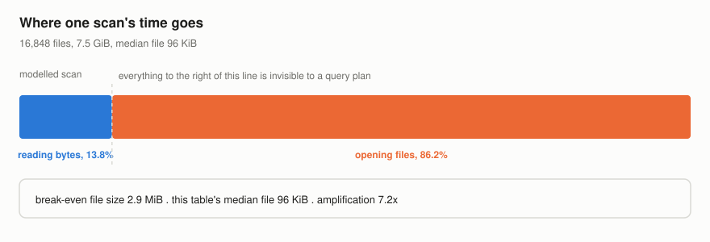
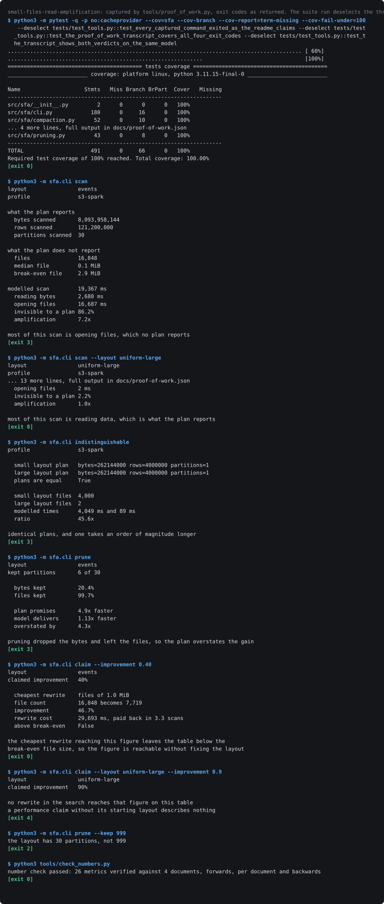
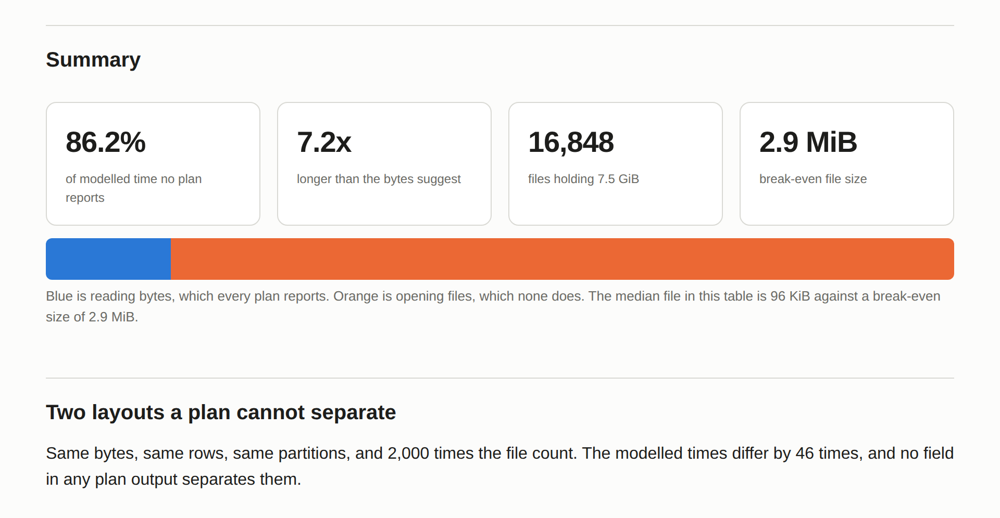

# small-files-read-amplification

[](https://github.com/Sruthi0510-data/small-files-read-amplification/actions/workflows/ci.yml)

A query plan reports bytes scanned and rows scanned. Both are properties of the
data, which is why a planner can know them: it reads the table's own metadata to
decide what to do.

The cost that dominates a badly laid out table is neither. It is paid once per
file, for finding the object, opening it, reading its footer and building a
reader, and on object storage the first of those is a network round trip that
costs the same for a tiny file as for an enormous one. A planner cannot report
it, because it is not a property of the data at all.

So the arithmetic splits in two, and only one half appears in any plan you will
ever read:

```
time  =  per-file cost x file count   +   bytes / throughput
         \_____ no plan reports this ____/   \_ every plan reports this _/
```

On the shipped table, **86.2% of the modelled scan is the half no plan reports**,
and the scan takes **7.2 times longer** than its bytes alone would suggest.

## The table

A month of event data on S3, read by Spark. The table holds 16848 files across 30 partitions and
7.5 GiB. The older days have been compacted by a nightly job. The most
recent week has not, because the nightly job is behind, which is the normal
state of a nightly job.

The median file is 96 KiB and the mean is 469 KiB, and the gap between those two
numbers is the whole story: **99.7% of the files** are under a megabyte and they
hold **20.4% of the bytes**. A dashboard reporting average file size says this
table is fine.



## Two layouts no plan can tell apart

```
$ sfa indistinguishable
  small layout plan   bytes=262144000 rows=4000000 partitions=1
  large layout plan   bytes=262144000 rows=4000000 partitions=1
  plans are equal     True
```

Same bytes, same rows, same partitions. One has **2000 times as many files**
than the other, and **one takes 46 times** as long to scan. There is no field in
any plan output that separates them, and the engine will happily tell you both
queries are reading the same quarter of a gigabyte.

## The break-even file size

Divide the per-file cost by the throughput and you get the file size at which
opening a file costs as much as reading it. Nothing about the table appears in
the formula.

On this profile the **break-even file size is 2.9 MiB**. Below it, a scan spends
more time opening files than reading them, and no amount of column pruning,
predicate pushdown or better compression changes that, because all three reduce
bytes and none of them reduces the file count.

<!-- table:profiles generated by tools/render_tables.py from exp01.json -->
| storage and engine | cost per file | throughput | break-even file | invisible to the plan |
| --- | --- | --- | --- | --- |
| `adls-databricks` | 25.0 ms | 120 MiB/s | 3.0 MiB | 86.8% |
| `gcs-bigquery-external` | 39.4 ms | 140 MiB/s | 5.5 MiB | 92.3% |
| `local-nvme` | 1.8 ms | 2,000 MiB/s | 3.6 MiB | 88.6% |
| `s3-spark` | 31.7 ms | 90 MiB/s | 2.9 MiB | 86.2% |
<!-- /table:profiles -->

The counterintuitive row is the last one. Local NVMe has a per-file cost two
orders of magnitude below object storage and a throughput three orders above, so
bytes get cheap faster than opens do and the break-even size goes **up**. Fast
storage does not make small files less of a problem in relative terms. It makes
the absolute number small enough that nobody looks, which is why a benchmark run
on a laptop reports that the layout is fine.

## Why partition pruning disappoints

This one follows directly from the arithmetic and is still a surprise every
time.

Pruning this table to the recent week leaves it reading the files that hold
20.4% of the bytes, and the plan says so, and the plan is right. The scan does not get five times faster,
because the recent partitions hold almost all of the files and least of the
bytes, so pruning removed the cheap half of the cost and left the expensive one.

```
$ sfa prune
  bytes kept          20.4%
  files kept          99.7%

  plan promises       4.9x faster
  model delivers      1.13x faster
  overstated by       4.3x
```

The plan **promises a 4.9 times** speedup and the model **delivers 1.13 times**,
so the plan **overstates it by 4.3** times. The overstatement is systematic, it
points one way, and it is widest exactly where the layout is worst.

## What compaction buys, and what it costs

Compaction is the fix and it is not free. Rewriting a table reads every byte and
writes every byte, which is more work than any single scan of it, so the honest
unit is not the speedup but the number of scans it takes to pay the rewrite
back.

<!-- table:compaction generated by tools/render_tables.py from exp01.json -->
| target file size | files after | modelled scan | improvement | pays back after | above break-even |
| --- | --- | --- | --- | --- | --- |
| 64 KiB | 123,504 | 125,005 ms | -545.4% | never | no |
| 1,024 KiB | 7,719 | 10,326 ms | 46.7% | 3.3 scans | no |
| 8,192 KiB | 964 | 3,635 ms | 81.2% | 1.5 scans | yes |
| 32,768 KiB | 241 | 2,919 ms | 84.9% | 1.4 scans | yes |
| 131,072 KiB | 60 | 2,740 ms | 85.9% | 1.3 scans | yes |
| 524,288 KiB | 15 | 2,695 ms | 86.1% | 1.3 scans | yes |
<!-- /table:compaction -->

The improvement **caps out at 86.1%** and the **break-even target reaches 72.3%**
of that on its own, **pays for itself in 1.8 scans**, and leaves nothing much on
the table. Everything above the break-even size is a long tail of diminishing
returns bought at full rewrite price, which is worth knowing before configuring
a job to compact everything into enormous files.

## Pricing a performance claim

A resume line that reads "40% performance improvement" has no layout attached to
it, and the only honest way to read one is to ask what rewrite would have
produced it and what that rewrite cost.

```
$ sfa claim --improvement 0.40
  cheapest rewrite    files of 1.0 MiB
  file count          16,848 becomes 7,719
  improvement         46.7%
  above break-even    False
```

The cheapest rewrite that clears 40% on this table targets **files of 1024 KiB**,
**actually delivers 46.7%**, pays itself **back in 3.3 scans**, and and still leaves
7719 files behind, all of them below the break-even size. So 40% is reachable
without fixing the layout, which makes it an unambitious number for this failure
mode rather than an impressive one.

That cuts both ways and the repository says so in both directions. A 40%
improvement on a table that was already well laid out would be a remarkable
result, and the same tool returns exit code 4 for it, because no rewrite in the
search reaches the figure and the honest answer is that the number does not
describe that table. A claim without its starting layout is not a weak claim. It
is not a claim.

## Proof of work

The transcript below was produced by running the commands, not by transcribing
them. `tools/proof_of_work.py` executes each one in a subprocess, records the
exit code, and fails the build when a command does not exit the way this README
says it does, so all four documented exit codes are demonstrated rather than
asserted.

Elapsed times and absolute paths are normalised so the committed image does not
change on every run; nothing else is touched, and the full untruncated output
with a SHA-256 of each command's bytes is in `docs/proof-of-work.json`.



The generated HTML report, screenshotted by Chromium as part of `make report`:



## Running it

Everything is offline and deterministic. No cloud account, no credentials, no
network call at runtime, and no benchmark: this is a model, and its parameters
are four numbers per profile sitting in `src/sfa/cost.py` where you can argue
with them.

```bash
git clone https://github.com/Sruthi0510-data/small-files-read-amplification.git
cd small-files-read-amplification
python3 -m venv .venv && . .venv/bin/activate
pip install -e ".[dev]"
make verify
```

```bash
sfa scan                           # split one scan into what a plan can and cannot see
sfa indistinguishable              # two layouts with identical plans
sfa prune --keep 6                 # what pruning promises against what it buys
sfa compact                        # sweep compaction targets, with payback
sfa claim --improvement 0.40       # price a quoted performance number
sfa profiles                       # break-even file size per storage profile
```

| code | meaning |
| --- | --- |
| 0 | the layout is sound: most of the scan is work the plan reports |
| 2 | the tool was handed something it cannot work with |
| 3 | read amplification was found |
| 4 | the question cannot be answered from what was supplied |

## What this is not

It is not a benchmark. Nothing here times a real query, and ADR-002 is about why
that is the right trade for this argument and what it costs: the magnitudes
depend on four numbers per profile that no test can verify against anybody's
cluster. The argument does not depend on their values, only on the per-file cost
being nonzero, which it always is.

It is not a claim that compaction is always worth it. The payback column exists
because a table read once a quarter and compacted every night is a table whose
maintenance costs more than its queries, and the tool will tell you that.

It is not a catalogue. ADR-003 lists what is missing, starting with caching,
which is the mechanism most likely to make a reader's real numbers differ from
these.

## Bugs the measurement found

**Seven division guards for states the types had already ruled out.** Every
property that divides by a modelled time carried a zero check. Branch coverage
showed all seven were unreachable: a layout must hold at least one file, a file
must hold at least one byte, and throughput must be positive, so a cost produced
by `scan_cost` is strictly positive. They are gone, and the invariant is written
down where the guards used to be.

**A validation argparse was already doing.** The layout lookup refused unknown
names, below an argparse `choices` list built from the same mapping. Unreachable,
and removed.

**A transcript that could not regenerate itself.** The capture runs the suite
and records its exit code, and the suite contains tests that assert every
command in the committed transcript exited as expected. A stale figure in this
README made the suite fail once, the capture recorded that, and from then on the
transcript tests failed because the transcript said the suite failed, which made
the suite fail, which is what the next capture would record. The captured suite
run now deselects the three tests that read the transcript back; they still run
in the full suite and in CI, and the title of the rendered image says the run
was narrowed.

**A comparison command that could only ever return one answer.** It compared two
hardcoded layouts, so its "these are distinguishable" branch could not be
reached. Rather than delete the branch, the command now takes `--left` and
`--right`, which makes it useful on any pair and makes the branch reachable.

## How the numbers stay true

Every figure in this document is produced by code that ran.
`tools/collect_metrics.py` re-measures every one into `docs/metrics.json`, and
`tools/check_numbers.py` fails the build when a document quotes one the code no
longer produces, across three passes: every metric must appear with its current
value, every document is searched separately for stale wording, and every number
in this README must correspond to a metric so a figure nothing re-measures
cannot quietly appear.

156 tests, 100.0% line and 100.0% branch coverage, and the suite runs offline
from a fresh clone.

## Reading order

1. `src/sfa/cost.py` for the two terms and the break-even size
2. `src/sfa/plan.py` for the type that deliberately lacks a file count
3. `docs/adr/` for the three decisions and their costs
